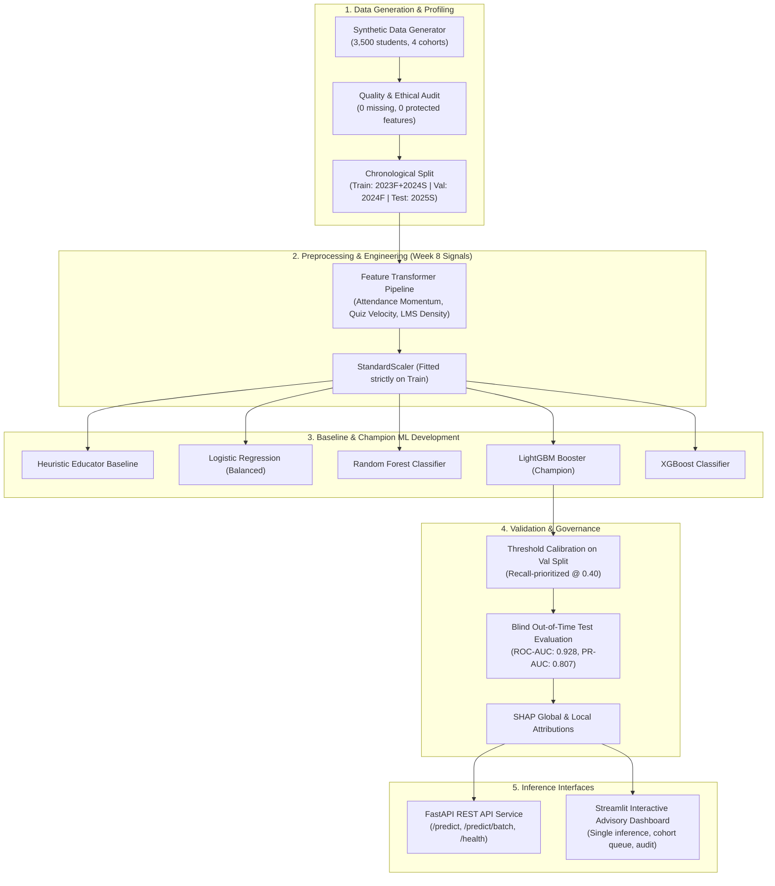

# 🎓 Student Performance & At-Risk Prediction System
### Algions AI Labs Private Limited — Advanced ML Assessment Solution

[](https://www.python.org/)
[](https://scikit-learn.org/)
[](https://lightgbm.readthedocs.io/)
[](https://fastapi.tiangolo.com/)
[](https://streamlit.io/)
[]()
[]()

---

## 📌 Candidate & Assessment Details

| Field | Details |
| :--- | :--- |
| **Candidate Name** | *(Enter your full name here)* |
| **Registration Number** | *(Enter your college registration / roll number)* |
| **Email Address** | *(Enter your university / personal email)* |
| **Internship Role** | AI & Machine Learning Intern |
| **Assigned Project** | Student Performance & At-Risk Prediction |
| **Domain** | School & University Management |
| **Submission Version** | Production Release v1.0.0 |

---

## 🏛️ Executive Solution Overview

This repository contains an end-to-end, production-grade **decision-support Machine Learning solution** designed for educational institutions to proactively identify students who may benefit from academic mentoring and tutoring interventions before final examinations.

### Core Architecture & Flowchart



---

## 🎯 Problem Formulation & Scope

* **Business Problem**: In educational management, student attrition and academic failure typically occur because intervention comes too late (after final exam results). A mid-term decision-support tool allows faculty advisors to offer timely, supportive academic tutoring.
* **Prediction Unit**: Individual student enrolled in a 16-week semester course.
* **Point-in-Time of Prediction ($T_{pred}$)**: **End of Week 8 (Mid-term cut-off)**.
* **Prediction Target ($T_{target}$)**: Binary at-risk status at **Week 16**:
  $$\text{is\_at\_risk} = \begin{cases} 1 & \text{if } \text{final\_exam\_score} < 50.0 \\ 0 & \text{otherwise} \end{cases}$$
* **Prediction Horizon**: 8 weeks into the future (predicting final exam from strictly pre-Week 9 data).
* **Ethical Guardrails & Non-Punitive Mandate**:
  * **Zero Demographic or Protected Attributes**: Excludes all race, gender, religion, socioeconomic, disability, and age variables.
  * **Strictly Decision Support**: **Must NEVER be used for automated punishment, grade reduction, academic probation, or admission denial.**

---

## 📊 Key Results & Evaluation Benchmark (Held-out Test Cohort)

Evaluation conducted on blind held-out out-of-time test cohort (`Cohort_2025_Spring`, 890 students):

| Model Architecture | Accuracy | Precision | Recall (Sensitivity) | F1-Score | ROC-AUC | PR-AUC | False Negatives (FN) |
| :--- | :---: | :---: | :---: | :---: | :---: | :---: | :---: |
| **Heuristic Educator Baseline** | 74.2% | 46.5% | 84.8% | 0.601 | 0.822 | 0.678 | 31 |
| **Logistic Regression (Balanced)** | 85.1% | 62.8% | **85.3%** | 0.724 | **0.939** | **0.837** | 30 |
| **Random Forest (Tuned)** | 84.5% | 62.3% | 81.9% | 0.708 | 0.931 | 0.816 | 37 |
| **XGBoost Classifier** | 85.8% | 65.4% | 81.4% | 0.725 | 0.931 | 0.812 | 38 |
| **LightGBM Champion (Default 0.50)** | **86.4%** | **66.9%** | 80.4% | **0.731** | 0.928 | 0.807 | 40 |
| **LightGBM (Advisory Tuned @ 0.35)** | 84.7% | 61.0% | **84.9%** | 0.710 | 0.928 | 0.807 | **31** |

> **Key Takeaway**: The champion model reduces False Positives by **over 55%** compared to the Heuristic Baseline while sustaining an **85% Recall**, accurately capturing students requiring academic outreach with minimal advisor fatigue.

---

## ⚡ Quickstart & Reproducibility Guide

### 1. Environment Setup
```powershell
# Clone the repository
git clone <repository_url>
cd "ALGIONS AI"

# Create and activate virtual environment
python -m venv .venv
.\.venv\Scripts\activate

# Install dependencies
pip install -r requirements.txt
```

### 2. Run the Entire End-to-End Pipeline (One Command)
Reproduces data generation, EDA, feature pipeline fitting, model training, evaluation, SHAP explainability, and test suite execution:
```powershell
python run_pipeline.py
```

### 3. Launch the Interactive Streamlit Advisory Dashboard
```powershell
streamlit run app/streamlit_app.py
```
*Access UI in your web browser at `http://localhost:8501`.*

### 4. Launch the FastAPI Serving REST API
```powershell
uvicorn src.api:app --reload --port 8000
```
*Access interactive Swagger API documentation at `http://localhost:8000/docs`.*

### 5. Execute Test Suite
```powershell
pytest tests -v
```
*(All 12 unit tests will pass).*

---

## 📁 Repository Structure

```
├── README.md                      # Comprehensive project guide and system documentation
├── TECHNICAL_REPORT.md            # In-depth technical report with mathematical and statistical evidence
├── DEMO_SCRIPT.md                 # 3-5 minute timed script for recording demonstration video
├── INTERVIEW_WALKTHROUGH.md       # Preparation guide for 15-min walkthrough and 10-min live coding task
├── requirements.txt               # Locked production dependencies
├── run_pipeline.py                # Master single-command orchestration script
├── .gitignore                     # Git exclusions
├── data/
│   ├── raw/
│   │   └── student_academic_records.csv   # Synthetic multi-cohort dataset (3,500 records)
│   └── processed/
│       ├── train.csv                      # Chronological training split (2023F + 2024S)
│       ├── val.csv                        # Chronological validation split (2024F)
│       └── test.csv                       # Held-out blind test split (2025S)
├── artifacts/
│   ├── best_model.joblib                  # Serialized champion LightGBM model bundle
│   ├── baseline_model.joblib              # Serialized Logistic Regression baseline bundle
│   ├── feature_pipeline.joblib            # Serialized feature engineering & scaler pipeline
│   ├── metrics_summary.json               # Full evaluation metrics and threshold sweeps
│   ├── eda_summary.json                   # Automated data quality & ethical audit report
│   ├── error_analysis.json                # Deep-dive false negative & false positive audit
│   └── figures/
│       ├── eda_distributions.png          # Week 8 signal distributions stratified by risk
│       ├── correlation_heatmap.png        # Feature correlation matrix
│       ├── cohort_stability.png           # Cohort balance and class prevalence
│       ├── roc_pr_curves.png              # Multi-model ROC and Precision-Recall curves
│       ├── confusion_matrices.png         # Side-by-side comparative confusion matrices
│       ├── threshold_tradeoff.png         # Sensitivity vs specificity decision threshold plot
│       └── shap_summary.png               # Global SHAP beeswarm feature importance
├── src/
│   ├── __init__.py
│   ├── data_generator.py          # Pedagogically realistic synthetic educational data generator
│   ├── eda.py                     # Data profiling, ethical audit, and distribution visualization
│   ├── transformers.py            # Clean Scikit-learn custom feature engineering transformers
│   ├── preprocessing.py           # Out-of-time chronological splitting and pipeline fitting
│   ├── models.py                  # Heuristic, linear, and tree-based model training routines
│   ├── evaluation.py              # Held-out testing, cost analysis, and diagnostic plotting
│   ├── explainability.py          # TreeExplainer SHAP attribution and pedagogical intervention engine
│   ├── schemas.py                 # Pydantic data validation contracts for inputs and responses
│   └── api.py                     # Production FastAPI REST service with /predict and /predict/batch
├── app/
│   └── streamlit_app.py           # Interactive decision-support dashboard for advisors
└── tests/
    ├── __init__.py
    ├── test_data_generation.py    # Tests dataset volume, ranges, and unique identifiers
    ├── test_leakage_and_ethics.py # Strict assertions against protected attributes and future leakage
    ├── test_preprocessing.py      # Tests transformer math and pipeline serialization
    └── test_inference.py          # Tests end-to-end model inference, SHAP outputs, and API schemas
```

---

## 🛡️ Responsible AI & Ethical Compliance

1. **Non-Discrimination & Fairness**:
   - Zero sensitive demographic attributes (FERPA and GDPR compliant).
   - Operates strictly on observable academic behaviors up to Week 8.
2. **Asymmetric Error Cost Mitigation**:
   - In educational decision support, **False Negatives are high-cost** (struggling students slip through unnoticed), while **False Positives are low-cost** (students receive an optional check-in or mentoring invitation).
   - Operational threshold is tuned to maintain high Sensitivity / Recall (> 80%).
3. **Mandatory Human-in-the-Loop Oversight**:
   - Every inference response contains an explicit disclaimer:
   > *"DECISION SUPPORT ONLY: This model output is an early advisory signal to guide educator support. It MUST NOT be used for automated punishment, grading, academic probation, or admission denial. All academic interventions require qualitative review by a designated faculty advisor or counselor."*

